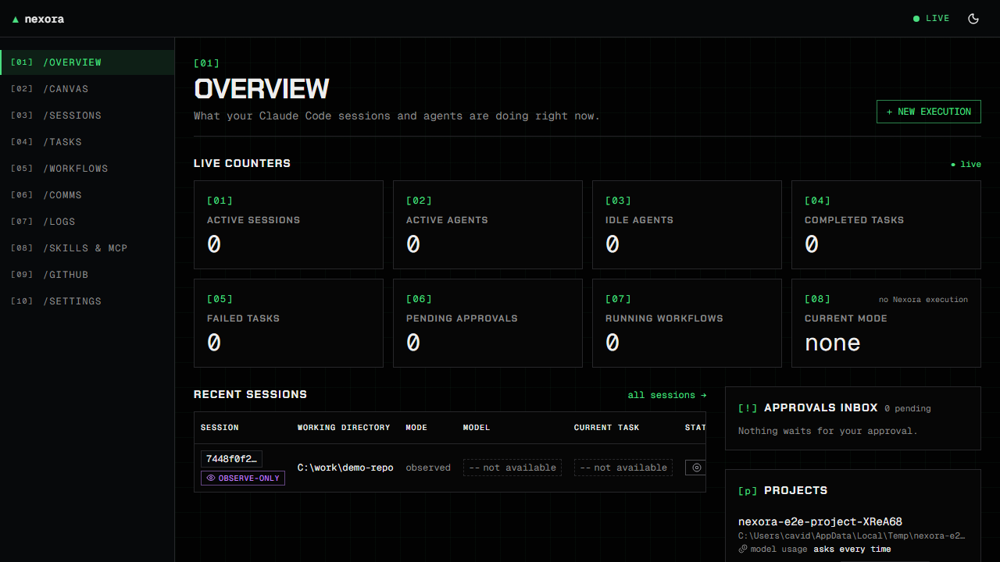
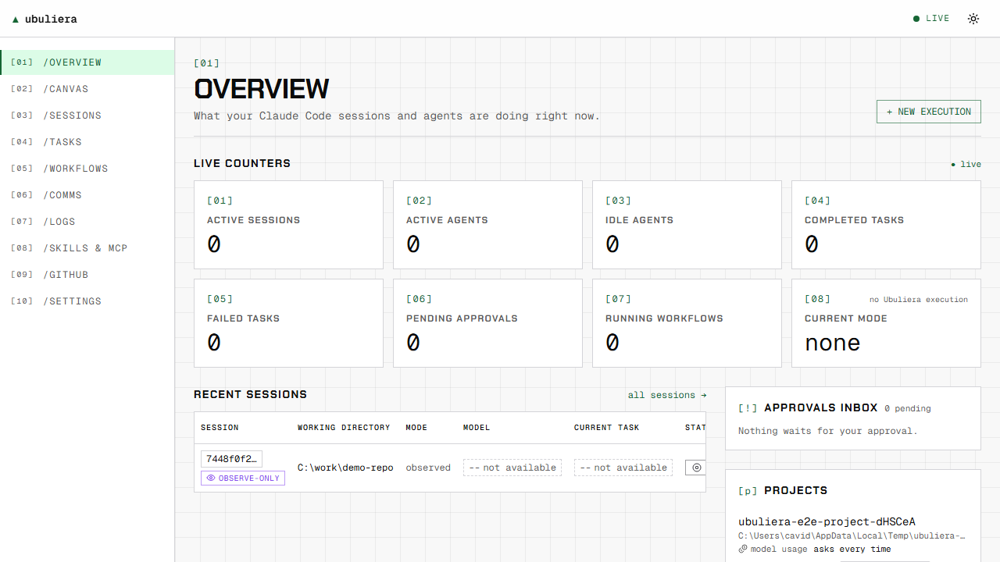
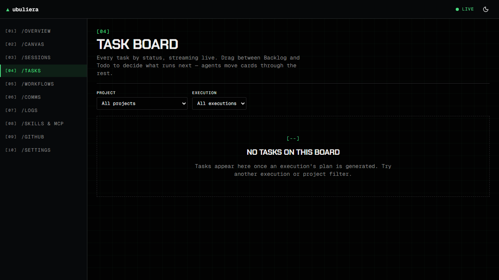
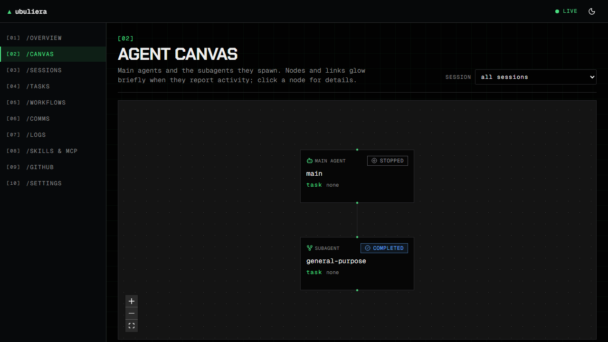

# Ubuliera

Ubuliera is a local AI development orchestration platform for **Claude Code**. It brings Claude
Code sessions, subagents, Agent Teams, workflows, skills and MCP integrations into one real-time
control center: describe a task, pick how it should run, approve the plan, and watch every agent,
tool call and file change live at <http://localhost:3022>.

It runs on your machine, binds to loopback by default, uses only documented Claude Code
interfaces, and never fakes a capability: anything a runtime cannot do is shown as unavailable,
with the reason.

## Features

- **Live monitoring** of Claude Code sessions you start yourself (via `http` hooks Ubuliera installs
  after you confirm a preview): sessions table, agent canvas (main → subagents), agent details,
  live logs with full-text search and JSONL/CSV export, replay after reconnect.
- **Task → execution**: local task analysis, five execution modes — Multi-Session, Agent Teams,
  Subagents, Workflow, Hybrid — five strategies, follow-up questions, a plan with dependencies,
  owned paths and conflict handling, then approval.
- **Isolation**: every managed execution works in its own git worktree under
  `<repo>/.ubuliera/worktrees/`; nothing is pushed.
- **Human control**: approvals inbox (never auto-approves, no timeouts), Stop, Interrupt & hold,
  Resume, Restart and messages — each enabled only where the runtime supports it; audit log of
  every decision.
- **Task board**: Kanban per execution with keyboard drag and server-validated moves.
- **Workflow editor**: versioned graphs with agent, skill, MCP tool, condition, approval and
  parallel fork/join nodes.
- **Native Agent Teams**: the team lead runs in a terminal you can see and type into; teammates and
  tasks appear from hooks and team files.
- **Skills, MCP and GitHub views**: everything your Claude Code configuration provides, with
  health and permission status, secrets always redacted; read-only GitHub data through `gh`.
- **Ubuliera MCP server** (optional): let another agent list sessions, plan and start executions
  with scoped API tokens — risky tasks still wait for a human.
- Dark (default) and light themes, keyboard accessible, axe-checked.

## Quickstart

Requirements: Node.js ≥ 22.12, npm ≥ 11, git, Claude Code installed and logged in
([details](docs/setup/prerequisites.md)).

```bash
npm ci
npm run build
npm start                 # http://localhost:3022
```

Then on the Overview page: **Register project** → **Install hooks** (review, confirm) → run
`claude` in that project. Your session appears with its first event.

Development mode with hot reload: `npm run dev` (dashboard on 3022, API on 3023 behind the
proxy).

## Screenshots

| Dark                                                         | Light                                                          |
| ------------------------------------------------------------ | -------------------------------------------------------------- |
|  |  |

| Task board                                     | Agent canvas                                                               |
| ---------------------------------------------- | -------------------------------------------------------------------------- |
|  |  |

Screenshots are regenerated by the a11y sweep: `UBULIERA_SCREENSHOTS=1 npx playwright test e2e/a11y.spec.ts --project=chromium`.

## Documentation

| Topic                                        | What it covers                                                  |
| -------------------------------------------- | --------------------------------------------------------------- |
| [Prerequisites](docs/setup/prerequisites.md) | versions, GitHub CLI per OS                                     |
| [Installation](docs/installation.md)         | install, production vs development, first session, uninstall    |
| [Configuration](docs/configuration.md)       | environment variables, ports 3022/3023, data dir, remote access |
| [Runtime setup](docs/runtime-setup.md)       | Claude Code login, hooks, Agent Teams flag, node-pty, gh        |
| [MCP setup](docs/mcp-setup.md)               | Ubuliera's `/mcp` endpoint, API tokens, external MCP servers    |
| [Usage examples](docs/usage-examples.md)     | step-by-step walkthroughs and REST/MCP examples                 |
| [Troubleshooting](docs/troubleshooting.md)   | common errors and fixes                                         |
| [Limitations](docs/limitations.md)           | what Claude Code does not allow, and known gaps                 |

Design documents: [spec](specs/001-ai-orchestration-platform/spec.md),
[plan](specs/001-ai-orchestration-platform/plan.md),
[research](specs/001-ai-orchestration-platform/research.md),
[contracts](specs/001-ai-orchestration-platform/contracts/).

## Architecture in one paragraph

One Node process (`apps/server`) runs a Hono REST API, a Socket.IO realtime gateway, the optional
MCP endpoint and the orchestrator over SQLite (Drizzle, WAL, FTS5). Runtimes sit behind one
adapter interface with honest capability profiles: Claude Agent SDK and headless CLI for managed
sessions, an interactive `claude` in a PTY for Agent Teams leads, and hook-observed external
sessions. The React dashboard (`apps/web`, Rsbuild, TanStack Router/Query, Zustand, Tailwind,
shadcn/ui, React Flow) is served by the same process in production. Shared zod schemas live in
`packages/contracts`.

## Development

```bash
npm run lint && npm run typecheck
npm test                 # Vitest: contracts, server (unit/contract/integration), web
npm run test:e2e         # Playwright + axe on the production build (fake runtime)
npm run load-test --workspace @ubuliera/server -- --url http://127.0.0.1:3022
```

See [CLAUDE.md](CLAUDE.md) for the repository layout, module map and conventions.
